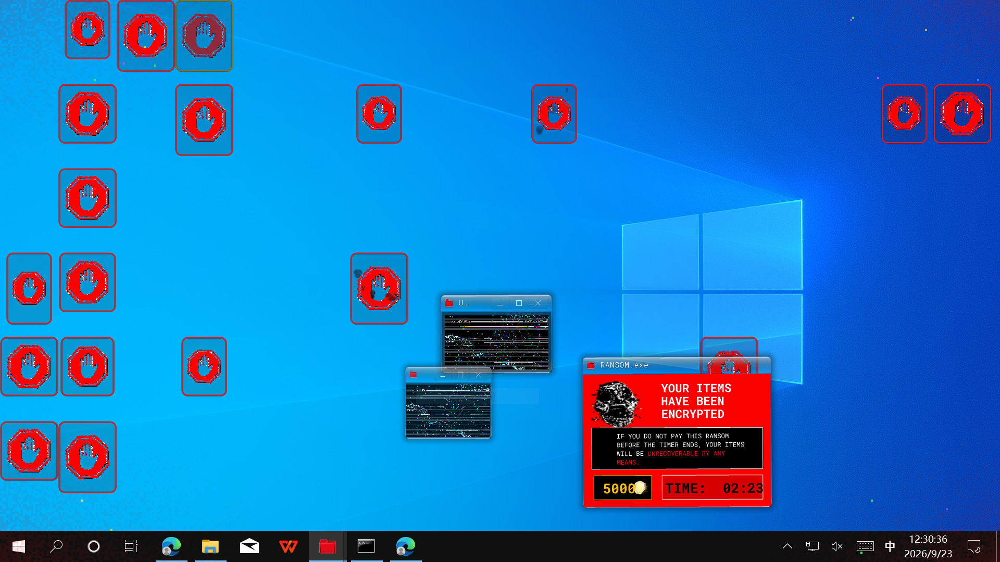
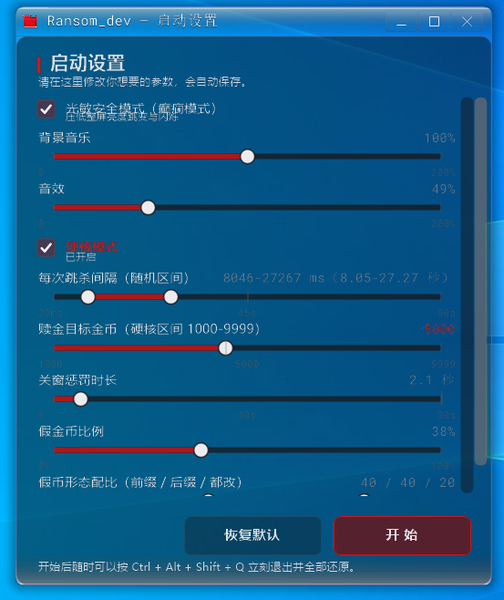
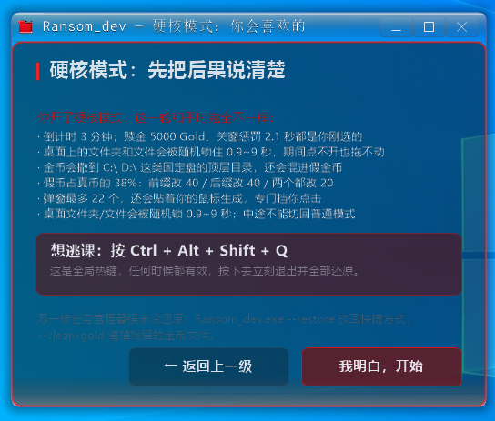

# Ransom_dev

<p align="center"><a href="./README.md">English</a> | <a href="./README.zh-CN.md">中文</a></p>

Fan art lives in [GALLERY.md](GALLERY.md).

A Windows desktop prank that turns the Ransom (A-90) encounter from DOORS into something that really moves your desktop around. The loop: a face fades in somewhere on screen and you have to hold still; the red stop sign flashes for a moment and that's when the check happens. Hold still and it leaves. Move, and the screen fills with popups, your desktop shortcuts get marked "encrypted", every open program is swept into the taskbar, and you have 90 seconds to scrape together 500 Gold to buy it all back. Miss the deadline and it ends in a jumpscare, with the locked shortcuts in the Recycle Bin.

Written in C++20 with Win32 and GDI+. Every asset is compiled into the exe, so the build output is a single file.



*The ransom phase, captured full screen at 1920 × 1080.*

> Heads up: this build does modify your desktop — it moves icons, blocks right-clicks, minimizes windows, and on timeout drops shortcuts into the Recycle Bin. All of it is reversible; the rollback path is in [Safety valve and rollback](#safety-valve-and-rollback). Read that section before the first run.

---

## About the assets in this repository

The images and audio in this project are partly licensed, partly downloaded from the wiki, and the icon comes from another repository:

| What | Source | Notes |
|---|---|---|
| `assets/image/`, `assets/audio/`, `assets/ransom.ico` | DOORS (a game on Roblox) | A-90's appearance, the stop sign, the theme, and the sound effects are all the original rights holder's assets |
| `assets/RobotoMono-VariableFont_wght.ttf` | Google Fonts | Roboto Mono, SIL Open Font License 1.1, freely redistributable |
| `Ransom_dev/src/third_party/` | stb_vorbis, minimp3 | Public domain / MIT / CC0 dual-licensed, see [NOTICE.md](NOTICE.md) |

This is a personal, learning-oriented fan project. The code is MIT-licensed; the assets don't come with it. Whether to host this repository publicly is your call. If you do, either drop `assets/image/` and `assets/audio/` and keep only the code — it still compiles, it just degrades without those assets — or swap in assets of your own.

If someone shared this repository with you, the asset copyright is still with the original rights holder.

---

## Requirements

| Item | Requirement |
|---|---|
| OS | Windows 10 1809 or later |
| Compiler | Visual Studio 2022 (v143 toolset). The project file names `v145`; opening it in an older VS just needs a right-click on the project → "Retarget solution" |
| Components | The "Desktop development with C++" workload plus the Windows 10 SDK |
| Language standard | C++20 (the project already sets `/std:c++20`, nothing to configure) |
| Runtime | None. The CRT is statically linked (`/MT`), so the exe runs wherever you copy it |
| Other | PowerShell (the asset packing script runs during the build) |

The third-party decoders (ogg / mp3) are vendored as source in `Ransom_dev/src/third_party/`; nothing extra to download, no package manager to install.

## Building

### Visual Studio

Open `Ransom_dev.sln`, pick `Release | x64` (32-bit is `Release | x86`, which maps to the project's `Win32` platform), build.

### Command line

```powershell
msbuild Ransom_dev.sln /p:Configuration=Release /p:Platform=x64 /m
msbuild Ransom_dev.sln /p:Configuration=Release /p:Platform=x86 /m   # 32-bit; maps to the project's Win32
```

### Where the output goes

```
build\x64/x32\Release\Ransom_dev.exe     ← the whole thing, assets inside
build\x64/x32\Release\Ransom_dev.pdb
build\obj\...                            ← intermediates
```

The platform is still called `Win32` in the project file, but the build directory it produces is `x32`.

### How the assets get inside

At build time `tools/gen_assets.ps1` scans `assets/` and generates two files: `Ransom_dev/assets_gen.rc` (one `RCDATA` entry and numeric ID per asset) and `Ransom_dev/assets_gen.txt` (the name-to-ID list). `assets.cpp` reads the manifest under ID 1000 at startup to build its table, then pulls bytes with `FindResourceW`. So at runtime the program doesn't depend on the `assets/` directory — changing an asset means a rebuild, and what you get in exchange is a single-file output.

> The script decides whether to rewrite those two files by comparing contents, not timestamps. A new asset can easily arrive with an old timestamp (`Copy-Item` and unzip both preserve the original time), and a timestamp check would silently miss it.

## Running it

Double-click `Ransom_dev.exe`. It shows the [setup window](#the-setup-window) first, then, once you confirm the parameters, proceeds according to the settings.

For a first run, this order is a good way to see it once:

```powershell
# 1. Just look at the generated face, without touching your desktop
Ransom_dev.exe --face-demo idle

# 2. Look at the ransom window layout (renders to a PNG and exits)
Ransom_dev.exe --ui-preview preview.png --ui-grid

# 3. Now run the whole thing — but read "Safety valve" below first
Ransom_dev.exe
```

## The setup window

Every run starts here; all the parameters for the show are decided on this one screen:



Top to bottom: UI language, photosensitivity notice, background music, sound effects, game mode (normal / hardcore / idle), the random interval between jumpscares, the ransom goal (one entry for normal, one for hardcore), the window-close penalty duration, the fake coin ratio, the fake coin shape mix, and finally the hardcore-only coin drive range (which opens a 2D drive-letter page).

After "START" there's a pre-show notice screen ("Read this first" in normal mode, "Hardcore mode: read this first" in hardcore): it lists this run's values as they are and puts the exit combo `Ctrl + Alt + Shift + Q` front and centre. "START" begins the show; "← Back" returns to the setup.

> There are more controls than fit on one screen, so the right side scrolls: the wheel over a slider nudges that slider, the wheel over empty space scrolls the page. The two buttons at the bottom don't scroll and are always visible.

Parameters live in `%LOCALAPPDATA%\Ransom_dev\settings.ini`. To skip the setup window and start with the last-used values, pass `--no-setup`.

## Languages (language packs)

Every string you can see lives in `assets\lang\*.lang`; not one of them is hard-coded. The "UI language" dropdown at the top of the setup window takes effect immediately and writes itself into `[ui] language=` in `settings.ini` on the spot — only that one key, without waiting for "Start", so picking a language and immediately closing the window still sticks.

Language packs travel the same road as images and audio: `tools\gen_assets.ps1` compiles them into RCDATA resources in the exe, so the output stays a single file. Three ship in the repository:

| File | Code | Shown in the dropdown |
|---|---|---|
| `assets/lang/zh-CN.lang` | `zh-CN` | 简体中文 (default, and the fallback for missing keys in other languages) |
| `assets/lang/en-US.lang` | `en-US` | English |
| `assets/lang/ja-JP.lang` | `ja-JP` | 日本語 |

Adding a language is adding a file — no C++ changes at all: copy `assets/lang/zh-CN.lang`, rename it to `<code>.lang` (say `ko-KR.lang`), change `meta.name` to the language's own name (that's what the dropdown shows), translate the values on the right, leave the key names alone since the code looks them up by name, then drop it back into `assets\lang\` and rebuild. The dropdown picks it up automatically.

Format (the same notes are at the top of the file):

* One `key = value` per line; `#` or `;` starts a comment, blank lines are ignored.
* Values need no C++ escaping: one backslash is one backslash (`C:\ D:\`), one percent sign is one percent sign (`50%`).
* The exception is format strings (values containing `%d` / `%.1f` / `%s` / `%c`): the number, order, and type of placeholders can't change. Reword freely, carry the placeholders over untouched. A literal percent sign is still `%%`.
* A missed key is fine: it falls back to the `zh-CN` entry, and the UI doesn't go blank or crash.
* If the whole pack is gone (you deleted or renamed the `.lang`, or the ini holds a misspelled code), the next launch falls back to `en-US` instead of failing to open the window or printing raw key names everywhere.

The Chinese strings in `elog::Write` are not in a language pack — those are diagnostic lines written to a log file, invisible to the player, and they only exist in Chinese.

## Safety valve and rollback

Every desktop modification has a way back:

| Situation | How to get out |
|---|---|
| Stop immediately, any time | Press `Ctrl + Alt + Shift + Q`. It's a global hotkey, exempt from the detection logic, so it won't hurt you by accident; it works the same in hardcore mode — one press and you're out. |
| Coin shortcuts left behind | `Ransom_dev.exe --clean-gold` |
| Shortcuts went to the Recycle Bin | `Ransom_dev.exe --restore` |
| Swept windows didn't come back | Every clean exit path restores them; a Task Manager kill does not — in that case click the taskbar buttons. |
| Desktop icons moved | Right-click the desktop → View → toggle "Auto arrange icons" on and off; the icons snap back. |

Every clean exit path (paid / timeout penalty / safety valve / closed window) restores windows, deletes every generated coin shortcut, and puts the confiscated shortcuts back from the manifest.

## Hardcore mode

There's a hardcore toggle in the setup window (the window shakes when you flip it).



*With hardcore on, the pre-show screen lists this run's values one by one — that screen is meant to be read, not decoration.*

With it on, the run becomes:

| | Normal | Hardcore |
|---|---|---|
| Ransom countdown | 90 seconds | 3 minutes |
| Ransom goal | Adjustable 10 ~ 1000 (default 500) | Adjustable 1000 ~ 9999 (default 5000; anything above 9999 is truncated) |
| Coin denominations | 10 ~ 500 | 50 / 75 / 100 (about 74 real coins) |
| Theme | Original (trimmed to 1:30) | Remix (first 3:30 taken, sped up without pitch shift to 3:00) |
| Popups | Up to 14 at once | Up to 22, and they spawn against your mouse cursor to block clicks |
| Closing a child window | Adjustable 0 ~ 18s (default 10s) | Adjustable 0 ~ 30s (default 30s); closing 6 is fatal |
| Desktop locking | Shortcuts only | Also locks non-shortcut items (folders / files) at random for 0.9~9s, then they fade out green |
| Where coins land | Desktop only | Desktop plus the top-level folder of each fixed drive |
| Fake coins | None | Ratio adjustable 0 ~ 100% (default 35%), plus a dual-slider controlling the mix of "prefix changed / digits changed / both changed" |

The safety valve behaves the same in hardcore — one press stops it. That's deliberate: no "press twice" hurdle.

Two things need saying.

Fake coins. SOME of the spawned coins are fakes (35% by default, adjustable from 0 to 100% in the setup window). Their filenames have homoglyph substitutions (`Gold_50` → `G01d_5o`), and double-clicking one credits nothing. Instead you eat a penalty based on what was tampered with: prefix `Gold` replaced → the countdown loses "denomination × 0.1" seconds; digits replaced → the unpaid ransom grows by the denomination; both replaced → both fire at once. The mix of the three shapes ("prefix changed / digits changed / both changed") is set by one dual-slider track (same idea as the jumpscare interval slider): two beads cut 0~100 into three segments — left segment red = prefix changed, middle green = suffix changed, right red = both changed. The third segment has no bead of its own; it takes whatever remains after subtracting the first two, so all three can never be zero at once (push both beads to the far left and everything lands in "both changed"). Ransom added this way isn't permanent — real coins you collect afterwards pay that debt down first, and once it's settled the reading returns to normal.

No switching mid-run. One run goes all the way: whatever was set when the show started is what you get.

The toggle lives under `[game] hardcore=` in `%LOCALAPPDATA%\Ransom_dev\settings.ini`. In hardcore, coins scatter into the top-level folders of fixed drives like `C:\` and `D:\`, so `--clean-gold` scans those too (the test is still "targets this program and has `--pay`/`--token` in its arguments", so it won't touch your files).

## The show

```
IDLE (lurk) ──> FACE fades in at a random spot ──> CENTER (teleports to the middle, stop sign flashes)
                                              │
                              stop sign shows for ~1s — "don't move"
                                              │
                              ┌───────────────┴───────────────┐
                     held still │                               │ moved
                              ▼                               ▼
                        ESCAPED                      CAUGHT
                    shows its face once more        jumpscare ──> loading screen
                                                              │
                                                              ▼
                                                     RANSOM (90 seconds)
                                              · screen full of popups + icons marked "encrypted"
                                              · every open program swept into the taskbar
                                              · click the coin shortcuts on the desktop to reach 500 Gold
                                                              │
                                              ┌───────────────┴───────────────┐
                                        paid │                               │ timeout
                                              ▼                               ▼
                                        PAID                            PUNISH
                                    pay-up scene + full restore    jumpscare + shortcuts into the Recycle Bin
```

The "moved" test is generous: mouse displacement beyond the tolerance (20px by default), or any keypress, gets you caught. `--tolerance N` loosens it.

## Command-line options

| Option | Effect |
|---|---|
| `--phase NAME\|N` | Jump straight to a phase and hold there. Names: `lurk / fade in at a random spot / teleport to the centre / stop-sign check / escape / caught / paid / punish`, or an index 0-7 |
| `--no-auto` | Don't advance phases automatically (requires `--phase`; good for staring at a single frame) |
| `--tolerance N` | Mouse tolerance in pixels, default 20 |
| `--no-audio` | Don't start audio |
| `--no-overlay` | Don't start the desktop overlay (no boxes drawn, no click blocking) |
| `--overlay-topmost` | Pin the overlay on top (by default it sits at the desktop layer and normal windows cover it) |
| `--no-block-menu` | Don't block right-click menus on the encrypted icons (for troubleshooting) |
| `--no-lockdown` | Don't minimize other programs during the ransom (for troubleshooting) |
| `--no-guardian` | Don't start the two-process guardian (for debugging; also skipped automatically when a debugger is attached) |
| `--no-setup` | Skip the setup window and the pre-show notice, and use the values in `settings.ini` |
| `--diag PATH` | Write the diagnostic log to a file. A GUI-subsystem app has no console, so this is the only way to debug |
| `--face-demo MODE` | Show one face only: `idle` / `stop` / `attack` / `loading` |
| `--face-dump DIR` | Export the generated faces as PNGs and exit |
| `--audio-dump PATH` | Render all sound effects offline to a WAV and exit (for checking waveforms). Needs a working audio device — with no sound card it prints a reason and returns 1 |
| `--theme-dump PATH` | Export the processed theme to a WAV and exit (for listening). Doesn't need an audio device |
| `--ui-preview PATH` | Render the ransom window layout to a PNG and exit (for layout work, without running the show) |
| `--ui-grid` | With `--ui-preview`, overlay a coordinate grid on the preview |
| `--setup-ui PATH` | Render the setup window to a PNG and exit (for layout work) |
| `--notice-ui PATH` | Render the pre-show notice window to a PNG and exit |
| `--setup-grid` | With the two above, overlay a coordinate grid on the preview |
| `--setup-scroll N` | With `--setup-ui`, scroll the settings window down N pixels before exporting |
| `--payup` | With `--ui-preview`, preview the pay-up screen layout |
| `--fx-demo NAME` | Which effect layer to export: `glow` / `black` / `stop`. Running it on its own never exits — it needs `--fx-dump` |
| `--fx-dump PATH` | Export the effect layer as a PNG and exit |
| `--pay N --token T` | Send one payment over IPC for N coins with token T. Needs a running entity to do anything; with none it deliberately returns 3 |
| `--clean-gold` | Only scan for and delete leftover coin shortcuts, then exit |
| `--restore` | Restore confiscated shortcuts from the Recycle Bin using the manifest, then exit |
| `--image-dir DIR` / `--audio-dir DIR` | Override the asset directories (by default they come from the embedded resources in the exe) |

## How it compares to similar projects

> Checked 2026-09-27 against public information (GitHub API / file listings / READMEs / source keywords). Line counts are estimated at 32 bytes per line except this repository, which was counted. "Not verified" means no evidence was found — nothing was filled in on anyone's behalf.

### Identity and technology

| Project | Language / stack | Output | Repository size | Source volume | Activity |
|---|---|---|---|---|---|
| This repository | C++20 + Win32 + GDI+ | A single 7.7MB exe, all assets embedded, no runtime dependency | 16.2MB (6.8MB of assets) | 41 files / 16,133 lines (counted) | Changing locally; [public repository](https://github.com/Wqawa/Doors-ransom) 09-26 |
| [Ixars/ransomdoors](https://github.com/Ixars/ransomdoors) | C# / WPF (.NET) | Needs the .NET runtime; release artifacts committed straight into the repository | 598MB (.dll 364MB, 7 exes 56MB, .resources 151MB — build output fully committed) | 24 files ≈3.2k lines | Created 09-02, dead since 09-09; 102★ / 36 forks, 51 open issues |
| [khoichon/rans0m-crossplatform](https://github.com/khoichon/rans0m-crossplatform) | JS / Electron (libuiohook for the global input hook) | Windows / macOS / Linux | 50MB (reuses Ixars' assets directly) | 23 files ≈2.9k lines | 09-19 → 09-20; 3★ |
| [masashira0212-stack](https://github.com/masashira0212-stack/Doors-Ransom-A-90-Simulation) | Python + tkinter | `ransom.exe` + `ransom_setting.exe` (PyInstaller) | 6.25MB | 19 files ≈10k lines (lots of tests) | 09-04 → 09-07; 14★ / 7 forks |
| [deepcoolforce23/Ransom-Doors](https://github.com/deepcoolforce23/Ransom-Doors) | Python + Qt | Source | 11.8MB (7MB of audio) | 3 files ≈6k lines | 09-12 → 09-24 (still moving); 0★ |
| [CagriLo3169/A-90-Ransom-GDI](https://github.com/CagriLo3169/A-90-Ransom-GDI) | Not verified (source is not in the repository) | Only `Source-Code.tar.gz` 6MB + `dist.zip` 20MB | 24.9MB | — | 09-07 → 09-08; 3★ |
| [Kovax00/Ransomware-POC-Doors](https://github.com/Kovax00/Ransomware-POC-Doors) | Python | Source | 18.8MB (16.8MB of wav) | 12 files ≈1.6k lines | Created 09-06, shipped the same day; 1★ |
| [gidrobater/RansomDoorsPrank](https://github.com/gidrobater/RansomDoorsPrank) ／ [calamoy/ransom-doors](https://github.com/calamoy/ransom-doors) | — | — | Empty repositories | — | — |

### Behaviour and how much you can tune

| Project | Fidelity | Tunability | Desktop changes | Exit / restore |
|---|---|---|---|---|
| This repository | Face fade-in → stop-sign check → jumpscare → loading bar → coin ransom, the whole chain; original assets, with procedural fallbacks when they're missing | Setup window (three modes, a dozen-odd sliders, 2D drive page) + `settings.ini` + a pile of command-line options + language packs | Writes `.lnk` files only, blocks icons with a desktop overlay, sends shortcuts to the Recycle Bin; never real encryption; coin scattering can be limited to certain drives | Safety valve `Ctrl+Alt+Shift+Q`, one press; all four exit paths restore; `--restore` / `--clean-gold` |
| Ixars | The whole chain plus a `.crucifix` easter egg (finding it settles the debt); coins are `.gold1`~`.gold6` files scattered through the user folder; changes the cursor and dims the wallpaper red | Config window; opt-in "crash" (actually runs `shutdown /s /t 0`) or "run arbitrary command" | Drops files into user folders, changes wallpaper and cursor | Reset by default; shutdown / command execution are optional switches, off by default |
| khoichon | Copies Ixars (self-described line-by-line), `config.json` interoperable with the original | Electron config; coins can go to Desktop/Downloads, or into a temporary "drawer" directory | Drops coin files + changes wallpaper | Wallpaper has dedicated safety rules (self-described "used to get the wallpaper stuck red"), and every exit path restores |
| masashira0212 | Warning / STOP / LOADING / success-failure scenes + desktop overlay (a Japanese project, ships a Japanese PC guide) | A separate settings window (timers, popup scale, rebindable hotkeys) + a pile of test scripts + an antivirus false-positive writeup | Covers desktop icon cells (including non-`.lnk` shell items), changes wallpaper, registers a global hotkey | Has a "Restore desktop" button and hotkey; also a `recovery_watchdog.py` watchdog |
| deepcoolforce23 | Goes horror: the game becomes hunting for coins in dropdowns on windows that fling themselves around, with corrupted entries as instant losses and glitch windows flying about | Not verified | Moves files into `%APPDATA%\RansomIconData` and leaves a shortcut with the stop-sign icon posing as "encrypted", changes wallpaper, drops `WindowsSecurityHealth.lnk` into startup | Win and the files come back; ships `icon_backup.json` and `restore_desktop_icons()` |
| CagriLo3169 | Claims to be a harmless visual simulator; the README lists 25 Win32 GDI screen effects | Not verified | Not verified (source is inside the archives) | Not verified |
| Kovax00 | Real encryption: ChaCha20-Poly1305 + RSA-OAEP; shuts the machine down after 24 hours unpaid; ships `decrypt_tool.py` | Not verified | Really modifies files (encrypts them) | Only the private key plus 5 coins decrypt; the author labels it "not a simulation, irreversible" |

### A few observations

- Output: native Win32, a single exe, no runtime dependency — this is the only one in that column. Ixars needs .NET (and carries 598MB of build output in the repository), khoichon needs Electron, and masashira and deepcool need Python plus a packer.
- How far it goes on the desktop: only this repository and masashira0212 genuinely cover desktop icons. deepcoolforce23 goes further, moving files away and dropping an lnk into startup. Real encryption turns up in exactly one place, Kovax00, whose own author posted a destructive warning — the mirror image of this repository's red line (.lnk files only, never real encryption).
- A way out: "the safety valve stops it in one press + all four exit paths restore + `--restore` / `--clean-gold` as command-line backstops", written out together in public, is this repository alone. khoichon's restore is thorough too, covering every exit path, and masashira has a restore button and a watchdog.
- Tunables and languages: the dozen-odd settings, the 2D drive page and `settings.ini` are this repository alone, and so are the language packs.

> Two still unverified: [R4NS0M SIMULATOR](https://gamejolt.com/games/r4ns0m/1098499) (NatureStudio) on itch.io / GameJolt is a game-style fangame ("collect coins, pay the ransom, get your files back") that doesn't touch the system; its stack wasn't found. The other, an Android version by robotkjgh, has no page that could be found at all.

## Project layout

```
Ransom_dev.sln
├─ Ransom_dev/                  project files
│  ├─ Ransom_dev.vcxproj        output directories, toolset, and the asset packing target
│  ├─ Ransom_dev.rc             app icon + #include of the asset manifest
│  ├─ assets_gen.rc / .txt      ← generated, don't edit by hand
│  └─ src/
│     ├─ entity_main.cpp        entry point: command line, message loop, safety-valve hotkey
│     ├─ director.cpp           the encounter scheduler (that diagram above is this file)
│     ├─ face.cpp               A-90's face, generated procedurally
│     ├─ fx.cpp                 full-screen effect layer: corner glow, blackout, static
│     ├─ popup.cpp              the popup flood + the ransom main window
│     ├─ aero_window.cpp        window wrapper with a custom title bar
│     ├─ ui_layout.cpp          data-driven layout for the ransom window
│     ├─ desktop_overlay.cpp    desktop icon overlay + input interception (all the hooks)
│     ├─ lockdown.cpp           sweeps other programs into the taskbar and keeps them there
│     ├─ gold.cpp               coin shortcuts (double-clicking one = paying)
│     ├─ recycle.cpp            timeout penalty: shortcuts into the Recycle Bin
│     ├─ motion.cpp             the mouse/keyboard "did it move" check
│     ├─ audio.cpp / audio_clip.cpp   mixing and decoding (ogg/mp3)
│     ├─ assets.cpp / image_blob.cpp  reading the embedded assets
│     ├─ entity_log.cpp         diagnostic log
│     ├─ guardian.cpp           two-process guardian: a clean exit sends a Disarm event, a kill is punished by the watcher
│     ├─ settings.cpp           parameter persistence (reading and writing settings.ini)
│     ├─ setup_ui.cpp           setup window + pre-show notice (custom-drawn UI)
│     └─ third_party/           stb_vorbis (ogg), minimp3 (mp3), vendored source
├─ assets/                      assets (packed into the exe)
│  ├─ main_window.ini           ransom window layout
│  ├─ payup.ini                 pay-up screen layout
│  ├─ image/  audio/            images and audio
│  ├─ ransom.ico                app icon
│  └─ dump/                     faces the program generated (export samples, deletable)
├─ tools/gen_assets.ps1         scans assets\ and generates the resource manifest
└─ docs/screenshots/            screenshots used by the READMEs (not built, never packed into the exe)
```

## A few design trade-offs

Some corners were banged into along the way, and they're all noted in the code comments. A few:

Layout isn't hard-coded. The ransom window's position, size, and colours all live in `assets/main_window.ini`, so changing the layout needs no rebuild; with `--ui-preview` you can render that layout straight to a PNG, grid overlay included, and read coordinates off it.

Touching the desktop has to happen at the lowest level of the system. "Icons won't drag" and "no context menu comes up" are both done by swallowing messages with the `WH_MOUSE_LL` low-level hook. One counter-intuitive point: a drag has to be blocked on the button-down, not the button-up. The drag loop runs on this process's UI thread, and if it runs past the timeout the system gives a hook (about a second) the hook is silently unhooked — block on button-up and "drag slowly" gets around it. A hook getting unhooked is nasty in itself, so the overlay's timer re-installs the hook on every tick as a backstop.

Hit-test rectangles and drawn rectangles are two different sets. The boxes the overlay draws jitter every frame (so the icons look restless), but hit testing has to use the non-jittering set; otherwise the box drifts with the icons and a click that lands on an icon misses.

Teardown has to guard against whack-a-mole. After minimizing every window during the ransom, a few UWP windows pop themselves back. If the watcher just shoves them down again, that becomes a futile loop every 150ms (1159 times over a single run, measured). So it concedes: after 6 tries on the same window it gives up and writes the name to the log.

## Known limitations

- Platform: x64 is what gets shipped. x32 (the project's `Win32` platform) builds too — `.github/workflows/build.yml` builds both, runs the full set of command-line parameters on each, and drops both into `output/`.
- Multi-monitor: face positions and popup distribution are computed from the primary display's size; nothing happens on secondary displays.
- Taskbar: clicking a taskbar button can still pull a swept window up for a flash — that click is an ordinary mouse message to explorer, outside the keyboard hook's reach. Closing it off completely would need a `WH_SHELL` hook.
- UWP windows: see the whack-a-mole note above; a few UWP apps won't stay down.
- Kill leaves traces: killing the process from Task Manager leaves swept windows and coin shortcuts behind; clean up with `--clean-gold`.
- explorer restarts: the overlay finds the desktop window again, but icon positions are lost for one frame.

## License

Code: MIT, see [LICENSE](LICENSE).

Third-party and assets: see [NOTICE.md](NOTICE.md). The game assets are not covered by the MIT license.
